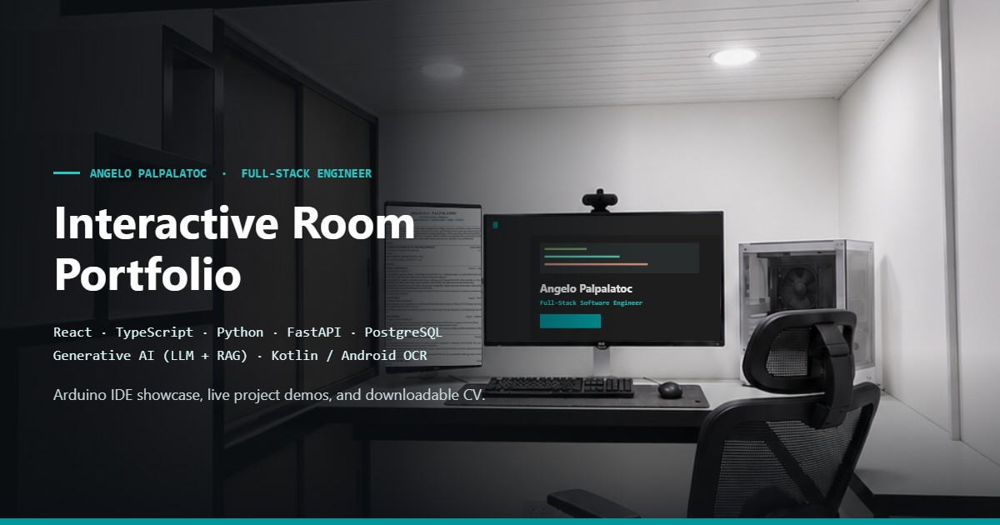

# Angelo Palpalatoc — Interactive Room Portfolio

**Live site:** [angelo-palpalatoc.vercel.app](https://angelo-palpalatoc.vercel.app/)



An interactive dual-monitor room portfolio built with **React**, **TypeScript**, **Tailwind CSS**, and **Vite**. Visitors explore a real desk setup with two live projected displays: a simulated Windows desktop running an **Arduino IDE–inspired portfolio** on the main landscape monitor, and an interactive **vector CV viewer** on the portrait monitor.

Inspired by [Henry Heffernan's portfolio](https://github.com/henryjeff/portfolio-website), engineered from scratch with CSS 3D projective transforms instead of WebGL so DOM text stays sharp, scrolling remains native, and keyboard/mobile accessibility works cleanly.

## Highlights

- **Dual-monitor CSS 3D homography:** Maps a `1280px` logical desktop and a `440px` portrait CV onto calibrated physical monitor corners (`src/monitorProjection.ts`) using a spring-damped camera with cursor parallax.
- **Responsive entry & phone reading view:** Desktop opens directly into the full-bleed dual-monitor desk; phones start in the portrait room view and expand apps or the CV into full-screen reading layouts with optional device-orientation tilt.
- **Arduino IDE portfolio (`src/portfolio/`):** Typed content, file explorer, tabbed navigation, collapsible Serial Monitor, compile verification flow, and showcases for **Lighthouse** (GenAI / LLM & RAG workspace), **Sec Renamer** (offline-first Kotlin & ML Kit OCR Android app with interactive UI demo), and this portfolio.
- **Zero-dependency Web Audio (`src/sound.ts`):** Synthesized tactile mouse press/release clicks, mechanical key thocks, subtle camera glides, and completion chimes with a persisted mute toggle.
- **Automated quality gates:** TypeScript strict checking (`tsc`), unused-code detection (`knip`), formatting (`prettier`), unit tests (`vitest`), and GitHub Actions CI.

## Run Locally

Requires Node.js 22.12+ and npm:

```bash
npm ci
npm run dev
```

Open the local URL printed by Vite (typically `http://127.0.0.1:5173/`).

## Scripts

| Command                | Purpose                                               |
| ---------------------- | ----------------------------------------------------- |
| `npm run dev`          | Start the Vite development server                     |
| `npm run check`        | Run TypeScript, Knip unused-code, and Prettier checks |
| `npm test`             | Run Vitest unit tests                                 |
| `npm run build`        | Type-check and build the production site into `dist/` |
| `npm run preview`      | Preview the production build locally                  |
| `npm run format`       | Format source and project configuration with Prettier |
| `npm run check:unused` | Run Knip's unused-file and dependency check           |

## Project Structure

```text
src/
  assets/               WebP room photograph and desktop wallpaper
  portfolio/            Arduino IDE components, typed data/state, Tailwind styles, and tests
  App.tsx               Spring camera, room/desk/monitor views, desktop shell, and mobile controls
  PortraitCvViewer.tsx  Interactive portrait-monitor CV reader with PDF open/download
  AutoRenameDemo.tsx    Guided UI-only mobile demo for Sec Renamer (fictional sample data)
  monitorProjection.ts  Four-corner CSS matrix3d projective homography helper
  sound.ts              Synthesized Web Audio micro-sounds and mute state
  LoadingState.tsx      Staged asset loader with slow-load retry feedback
  styles.css            Scene layout, calibrated monitor polygons, and responsive styles
public/
  Angelo-Palpalatoc-CV.pdf  Sanitized public 2-page CV
  og-preview.jpg            Open Graph / social link preview card (1200x630)
  portfolio-logo.webp       ACP desktop & favicon icon
  autorenamer-icon.svg      Sec Renamer app icon
  robots.txt, sitemap.xml   Search engine metadata
```
